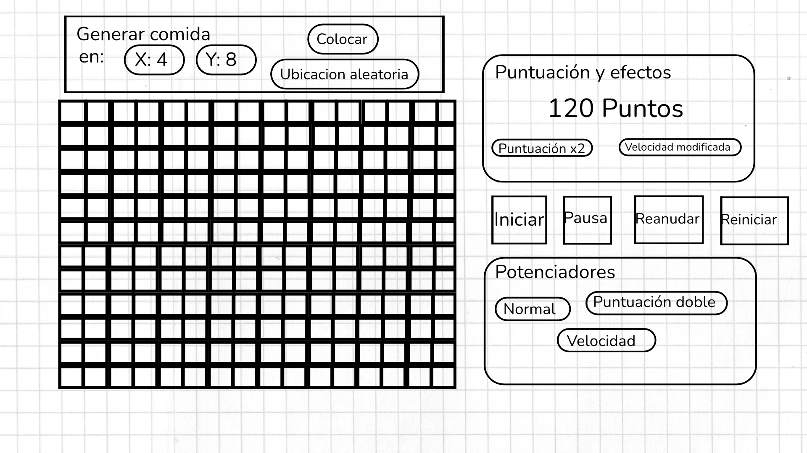
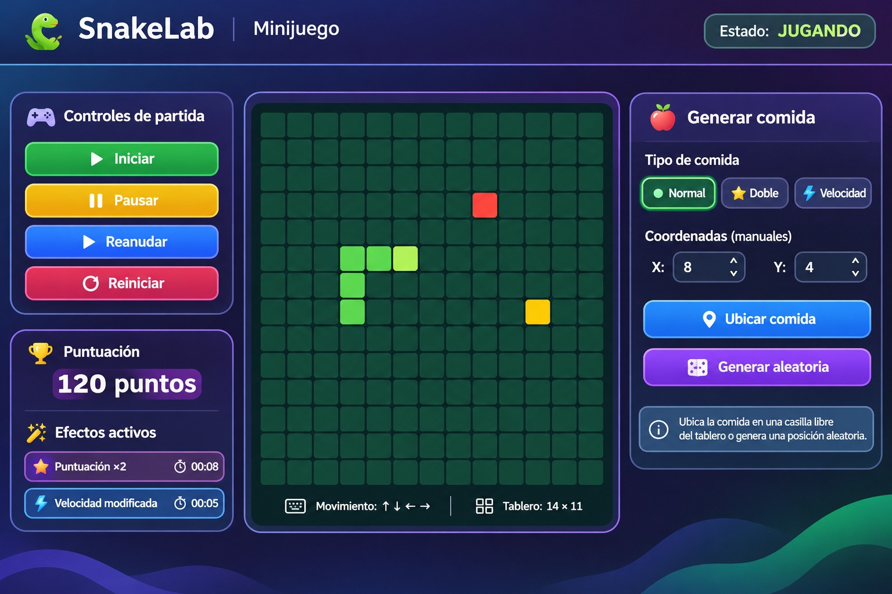
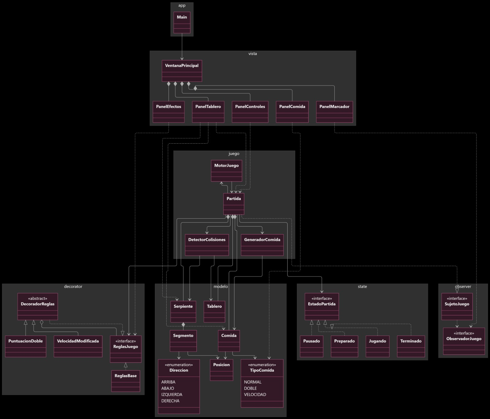

## Ingeniería en Ciencias de la Computación

### Programación Aplicada

### PL1.2 Patrones: SnakeLab

### Integrantes

#### - Andrés Mendez

#### - José Astudillo

## Mockup realizado

## Mockup mejorado con Stitch AI

## Diagrama UML

### Patron escogido:

### Observer
Observer lo usamos para notificar a la interfaz
en el caso de que existan cambios en el juego
por ejemplo cambio en el puntaje obtenido

