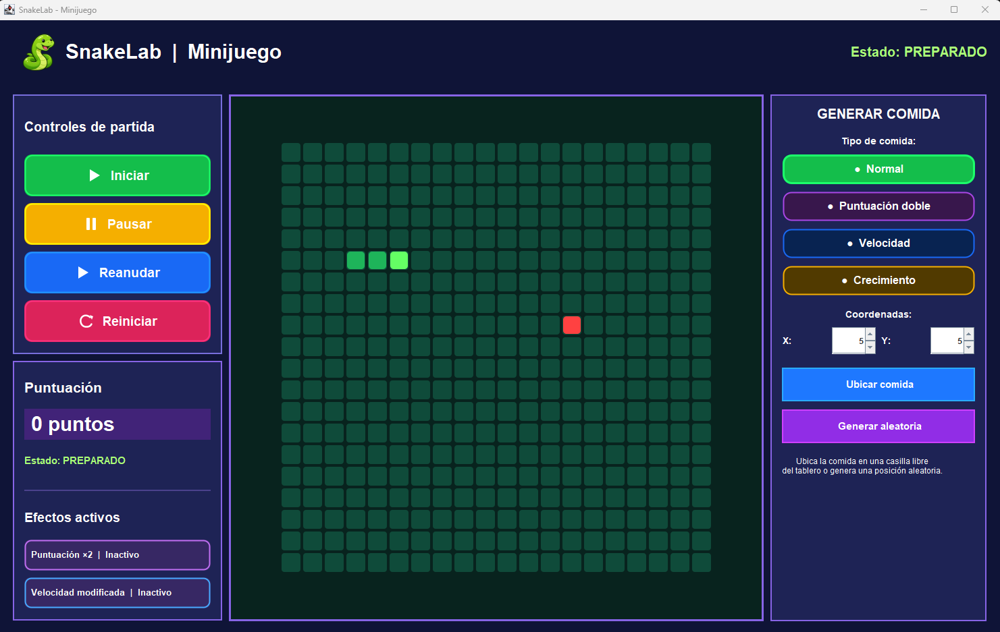
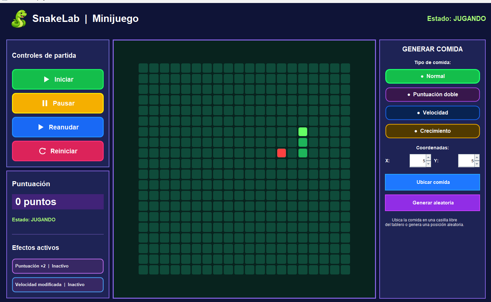
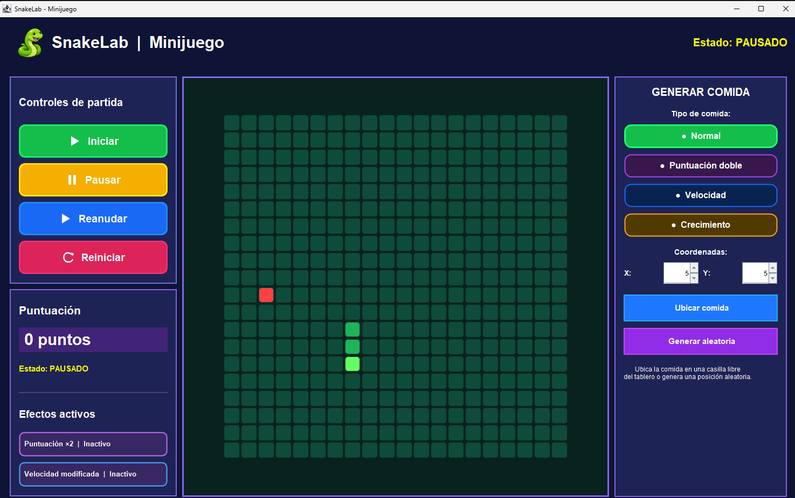
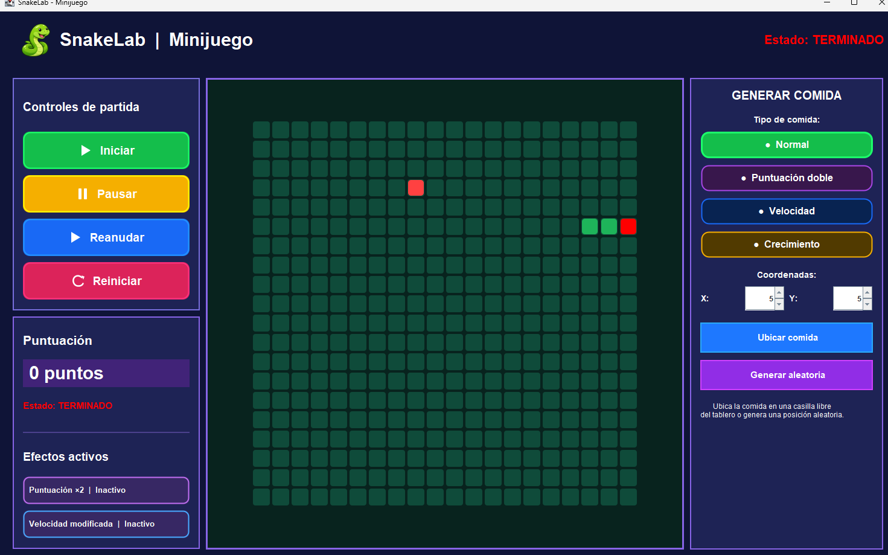
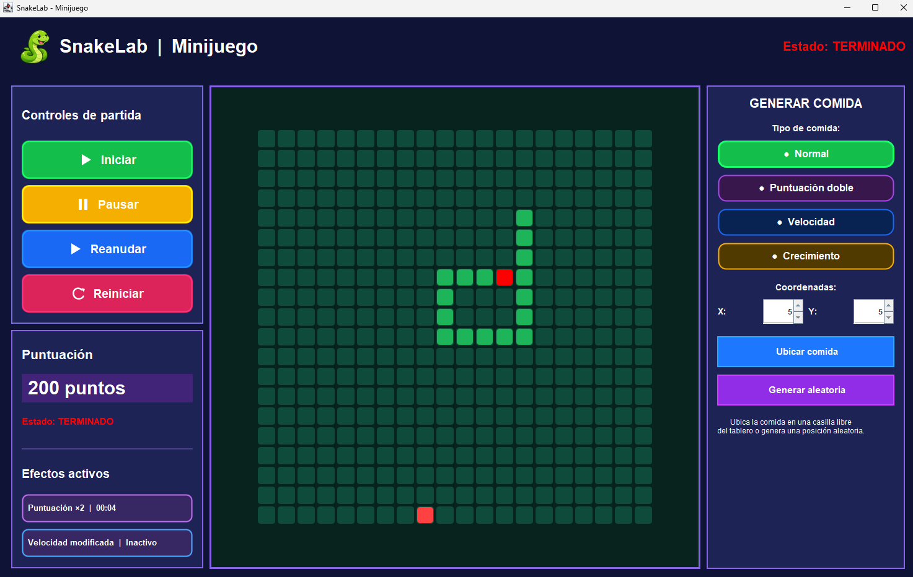
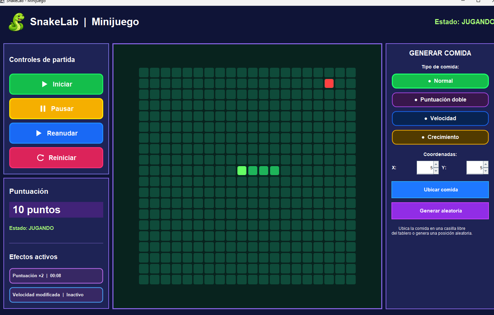
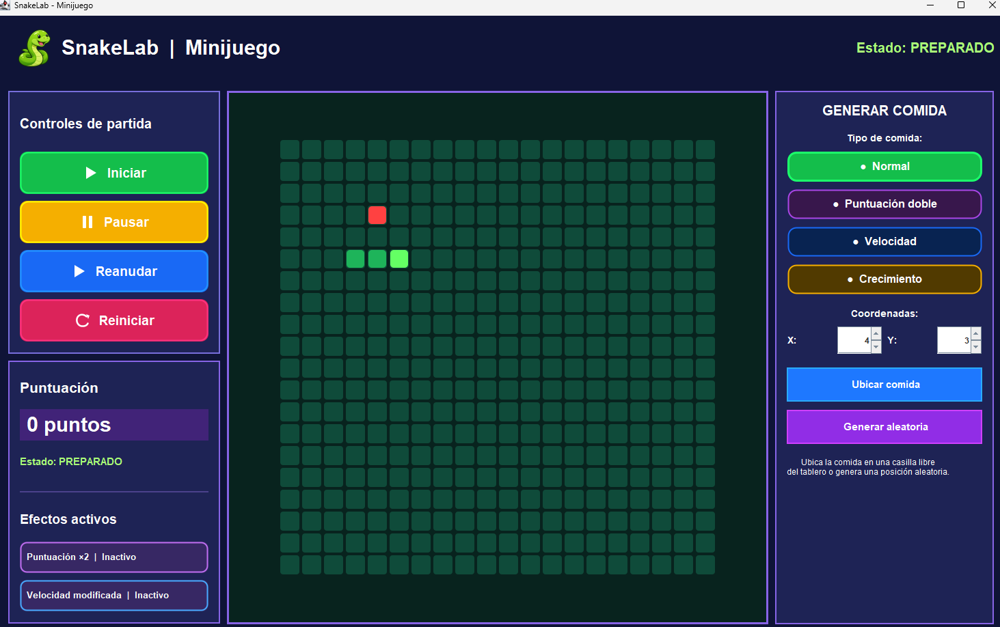
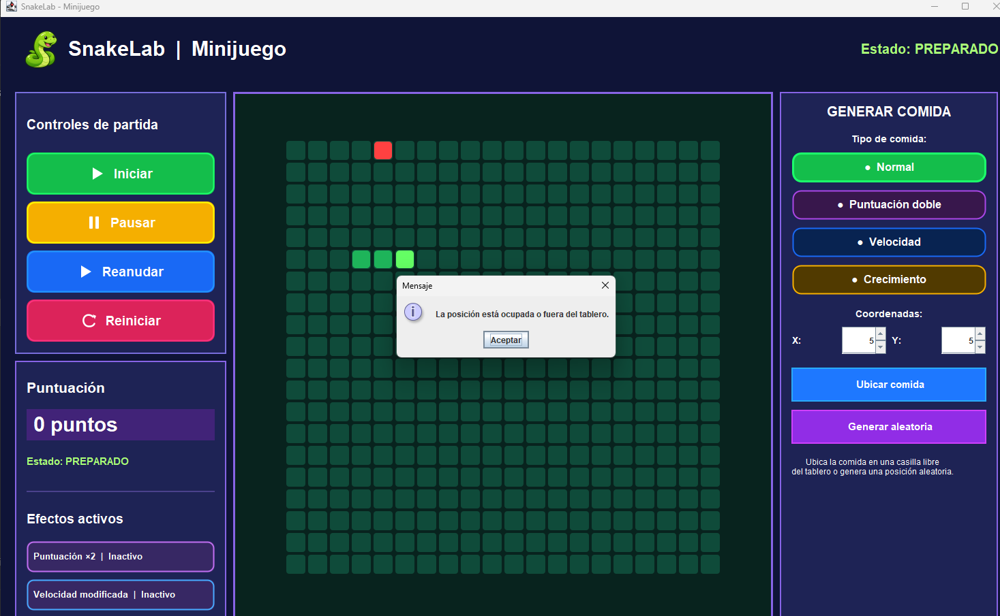

# Casos de prueba — SnakeLab

| ID | Operación / entrada | Resultado esperado | Aspecto validado | Evidencia |
|---|---|---|---|---|
| CA01 | Abrir SnakeLab | Se visualiza el tablero y la partida inicia en Preparado, sin movimiento. | State |  |
| CA02 | Iniciar y cambiar dirección con flechas | La serpiente se desplaza; se impide el giro directo de 180°. | Movimiento |  |
| CA03 | Pausar y reanudar | La posición y las duraciones de efectos no cambian durante la pausa. | State |  |
| CA04 | Provocar colisión con borde | La partida pasa a Terminado y detiene el desplazamiento. | State / colisión |  |
| CA05 | Provocar colisión con el cuerpo | La partida finaliza correctamente. | Colisión |  |
| CA06 | Consumir comida normal | La longitud aumenta y se actualiza la puntuación definida. | Mecánica |  |
| CA07 | Ubicar comida en coordenadas libres | La comida aparece exactamente en X e Y. | Panel manual |  |
| CA08 | Ingresar texto no numérico o coordenadas fuera de límites | Se rechaza la operación sin modificar la comida existente. | Validación |  |
| CA09 | Intentar ubicar comida sobre la serpiente | Se rechaza la casilla ocupada y se conserva el tablero. | Validación |  |
| CA10 | Presionar Generar aleatoria | La comida se ubica dentro de los límites y fuera del cuerpo. | Generación |  |
| CA11 | Solicitar comida sin casillas disponibles | Se informa que el tablero está completo y la partida se resuelve coherentemente. | Caso límite |  |
| CA12 | Consumir alimento de puntuación doble | Se activa el decorador y se observa la modificación de los puntos durante su vigencia. | Decorator |  |
| CA13 | Consumir alimento de velocidad | Se aplica el decorador y cambia el intervalo de desplazamiento. | Decorator |  |
| CA14 | Mantener ambos efectos activos | Se comprueba la composición de los dos decoradores y su finalización. | Decorator |  |
| CA15 | Reiniciar una partida | Se restablecen cuerpo, puntuación, velocidad, comida y efectos. | State / reinicio |  |
| CA16 | Ejecutar caso del tercer patrón | Una operación real demuestra la intervención de sus participantes. | Tercer patrón |  |
| CA17 | Ejecutar `java -jar SnakeLab.jar` | El juego abre desde terminal, sin iniciar el IDE, con la versión documentada. | Distribución |  |
